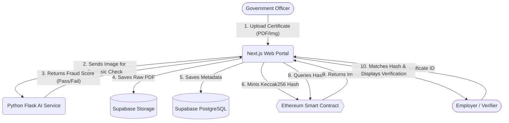
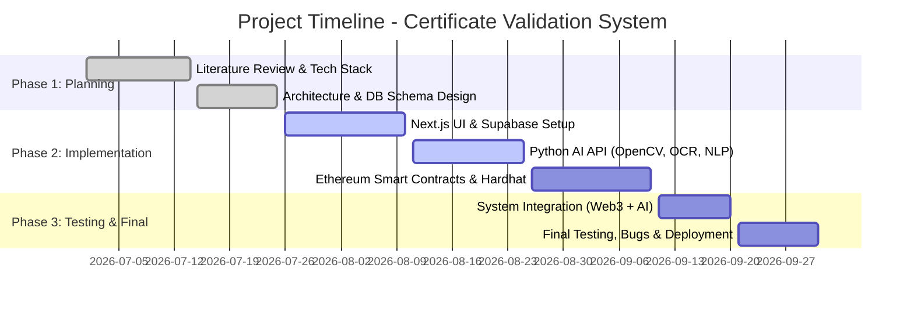

# Mini Project Review-1 (CSS7102)
**Project Title:** Online Blockchain-based Certificate Generation and Validation System

---

## Slide 1: Cover Page
- **Project Title:** Online Blockchain-based Certificate Generation and Validation System
- **Batch Number:** [Insert Batch]
- **Team Members:**
  - Shri Ram A U (20231CSE0602)
  - Srihari H (20231CSE0653)
  - Sharun Karthik (20231CSE0734)
- **Under the Supervision of:** Dr. Sampath A K

---

## Slide 2: Content
- Problem Statement
- Github Link
- Analysis of Problem Statement
- Timeline of the Project
- References

---

## Slide 3: Problem Statement
- **Problem Statement Number:** [Insert Number]
- **Organization:** Presidency University
- **Category:** Software
- **Problem Description:** The proliferation of fraudulent academic and professional certificates undermines institutional credibility. Traditional verification is slow, manual, and centralized databases are vulnerable to hacking. There is a need for a decentralized, automated system that detects document tampering and provides immutable cryptographic proof of authenticity.
- **Difficulty Level:** Advanced (AI + Web3 Integration)

---

## Slide 4: Github Link
- **Github Link:** https://github.com/Shriram-2005/certchain-blockchain-verification
- *(The repository is set to public access).*

---

## Slide 5: Analysis of Problem Statement (Tech Stack)
**Technology Stack Components:**
1. **Frontend & Backend (Next.js & TypeScript):** Handles user interface, API routes, and wallet integration (Ethers.js). Tailwind CSS used for UI design.
2. **Database (Supabase):** PostgreSQL database for storing user metadata, authentication roles, and raw PDF files (Supabase Storage).
3. **AI Microservice (Python/Flask):** OpenCV for Error Level Analysis (Image Forensics), Tesseract OCR for text extraction, and spaCy for semantic NLP analysis.
4. **Blockchain (Ethereum/Hardhat):** Solidity smart contracts for storing cryptographic certificate hashes (Keccak256) permanently on the ledger.

---

## Slide 6: Analysis of Problem Statement (Requirements)
**Software Requirements:**
- Node.js (v22+) & npm
- Python (v3.10+) with pip
- Tesseract-OCR Engine installed on OS
- Hardhat (Local Ethereum Node)
- Visual Studio Code

**Hardware Requirements:**
- Minimum 8GB RAM (16GB recommended for running AI models and local blockchain concurrently).
- Intel i5 / AMD Ryzen 5 or higher processor.
- 10GB free disk space.
- Active Internet Connection (for API calls and package installations).

---

## Slide 7: Analysis of Problem Statement (Architecture Diagram)
*(Use the Mermaid.js code below to generate the diagram at [Mermaid Live Editor](https://mermaid.live/), then screenshot and paste it into this slide).*

---

## Slide 8: Timeline of the Project (Gantt Chart)
*(Use the Mermaid.js code below in the [Mermaid Live Editor](https://mermaid.live/) to generate the Gantt chart image for your slide).*

---

## Slide 9: References (IEEE Format)
1. N. Nakamoto, "Bitcoin: A Peer-to-Peer Electronic Cash System," *Decentralized Business Review*, 2008.
2. V. Buterin, "A Next-Generation Smart Contract and Decentralized Application Platform," *Ethereum Whitepaper*, 2014.
3. H. Farid, "Image forgery detection," *IEEE Signal Processing Magazine*, vol. 26, no. 2, pp. 16-25, March 2009.
4. R. Smith, "An Overview of the Tesseract OCR Engine," *Ninth International Conference on Document Analysis and Recognition (ICDAR 2007)*, Curitiba, Brazil, 2007.

---

## Slide 10: Thank You
*(Add the yellow sticky note graphic from the template)*
**Thank You!**
*(Q&A Session)*
